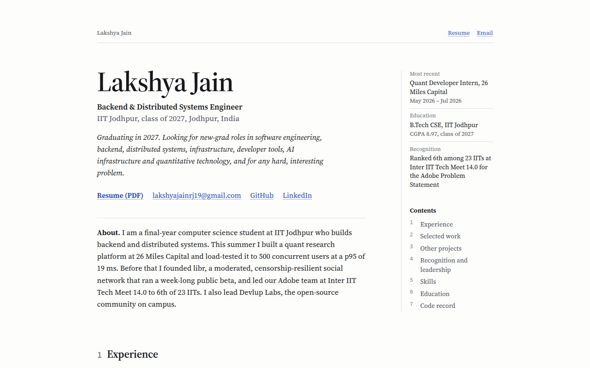
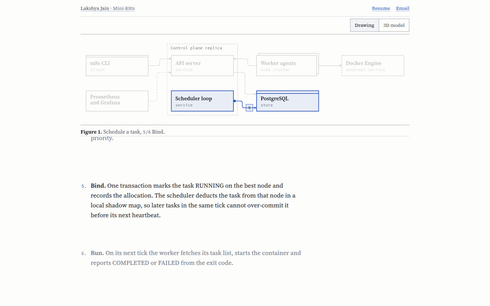
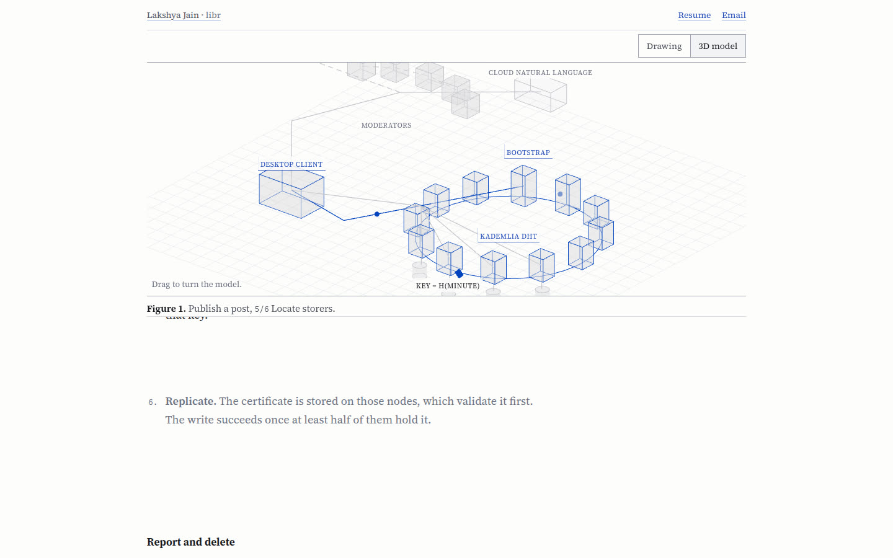
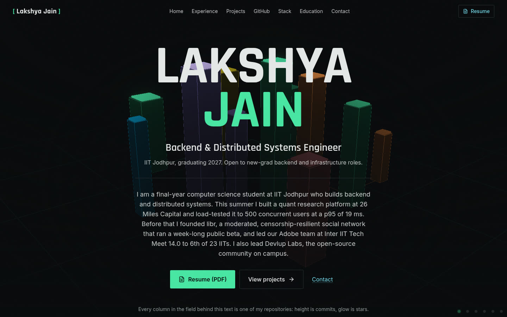
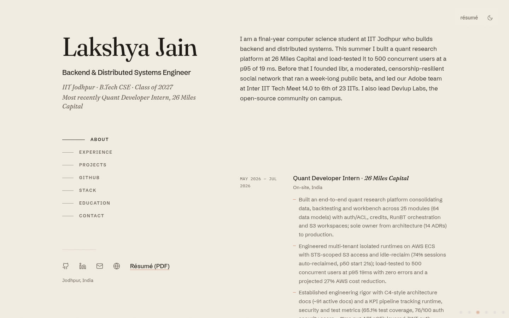
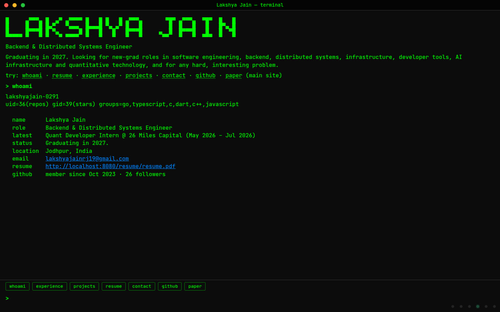

<a id="top"></a>

# Lakshya Jain: portfolio

The source of [me.lakshy.tech](https://me.lakshy.tech). One typed `portfolio.json` file is rendered as six different editions. The default, the **Systems Paper**, is typeset like a short engineering paper. It leads with the person, then the work, and every number on the page names its kind (measured, target, projected, self-reported, count) and its source.

<p align="center">
  
</p>

## Editions

| URL | Edition | What it is |
| --- | --- | --- |
| `/` or `?template=paper` | **Systems Paper** (`templates/paper/`) | The default. A portfolio first, with a case study page for each project |
| `?template=atlas` | **Blueprint** (`templates/atlas/`) | The same systems drawn as engineering sheets |
| `?template=0` / `1` | **Repository City** (`src/`) | Dark, with a WebGL field of repositories behind the hero |
| `?template=2` | **Editorial** (`src2/`) | A warm magazine layout, light and dark |
| `?template=3` | **Terminal** (`src3/`) | A command line: `whoami`, `projects`, `resume`, `github` |

The Paper's colophon links to the other editions. There are two quieter doors too: the Konami code opens the terminal, and clicking the closing ∎ five times opens a random edition.

## Case studies

Each selected project opens at `?project=<slug>` with four sections: the problem, how it works, the system and the evidence.

- On the home page, each system's diagram **plays its main flow on a loop**. A segmented timeline lets you jump to any step, and Pause stops it. The figure holds while you hover or focus it, pauses off screen, and never autoplays when reduced motion is requested.
- On a case study page, the figure stays pinned while you **scroll through the flows**, and each step lights the parts it uses. Phones get the looping player instead.
- **3D model.** Any system figure can switch to a 3D model. The models are made with three.js, and each one is a lazy chunk that loads only when opened.

<table>
<tr>
<td width="50%"></td>
<td width="50%"></td>
</tr>
</table>

The diagrams are drawn from each project's code, technical report or paper. Their specs live in `shared/content/architecture/`, and one layout engine (`shared/content/diagram/layout.ts`) renders them at any width.

<table>
<tr>
<td width="33%"></td>
<td width="33%"></td>
<td width="33%"></td>
</tr>
</table>

## Getting started

```bash
npm install
npm run dev          # http://localhost:8080
npm run build        # static site in dist/
```

The site is static: everything renders from `public/data/portfolio.json`, so no backend is needed to run or deploy it. Set `VITE_TEMPLATE_NUMBER` only if you want a different default edition. Leave it unset for the Paper.

## Editing the content

All content lives in **`public/data/portfolio.json`**, schema version 2. The types, with comments, are in `shared/content/schema.ts`.

| Key | Holds |
| --- | --- |
| `profile` | Name, role, `about` (first person), `availability`, contact details, the resume path and profile links |
| `experience` | Roles, with `start` / `end`, points and links |
| `projects` | Every project. `tier` is `system` (case study with a diagram), `supporting` (case study) or `other` (listed). Case studies carry `problem`, `approach`, `metrics` and an optional `diagram` id |
| `education`, `recognition`, `leadership`, `skills` | As named. `skills` has `groups`, `highlights` (with evidence) and `tools` |
| `sources` | Everything a metric can cite, by id |
| `github` | A snapshot of the GitHub numbers the code record shows |

Rules the site relies on:
- **Metrics.** Every metric needs a `kind` and a `source` that exists in `sources`.
- **Unverified items.** Mark anything not yet checked with `"verified": false`. It shows in development and is hidden in production.
- **First-paint values.** The first screen paints the name, role and resume path from `shared/content/curated/profile.ts` before the JSON arrives, so keep those in step with `profile`.

The older editions read the same file through `shared/content/legacy.ts`.

## Quality checks

```bash
npm run typecheck                      # strict TypeScript for shared/ and templates/
npm run lint
node scripts/qa/capture.mjs --base http://localhost:8080   # screenshots, overflow, headings, targets, LCP/CLS, console errors
node scripts/qa/check-bundle.mjs       # three.js and other heavy code stay out of the Paper and Atlas initial bundles
```

The QA scripts use a globally installed Playwright and a system Chrome (`CHROME_PATH`, default `/usr/bin/google-chrome`).

## Project structure

```
public/data/portfolio.json   the content (schema v2)
shared/content/              schema, build (JSON → typed content), legacy adapter, diagram specs and layout
shared/three/                WebGL guards and the 3D scenes
templates/paper/             Systems Paper (default)
templates/atlas/             Blueprint
src/                         boot, template selection, Repository City
src2/  src3/                 Editorial, Terminal
docs/                        content decisions, design briefs, project papers and resume sources
DESIGN.md  PRODUCT.md        design system and product context
```

## License

MIT

<p align="center"><a href="#top">Back to top ↑</a></p>
